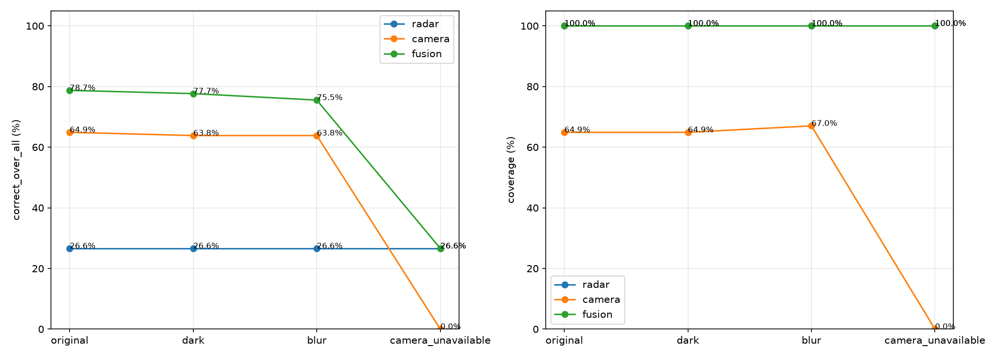
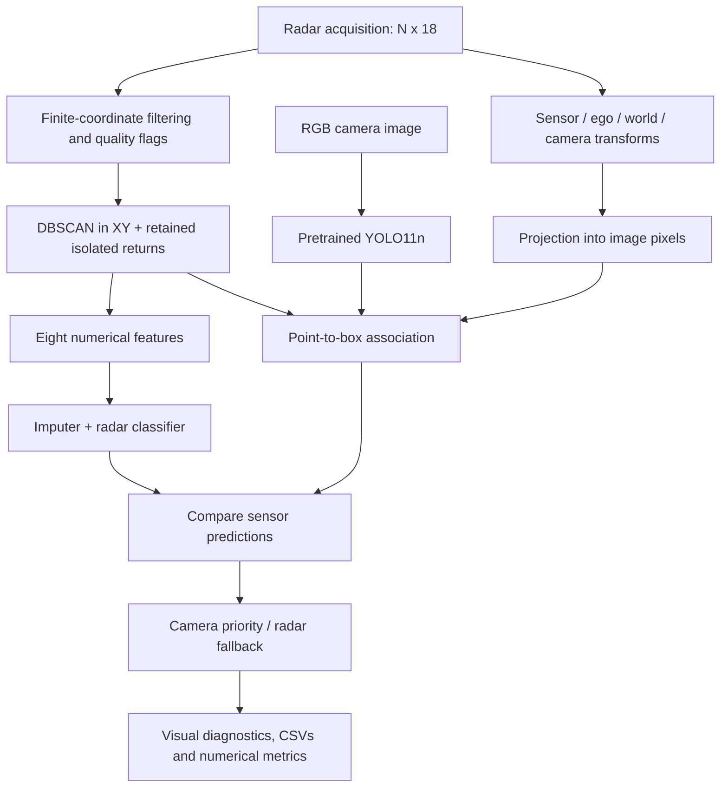
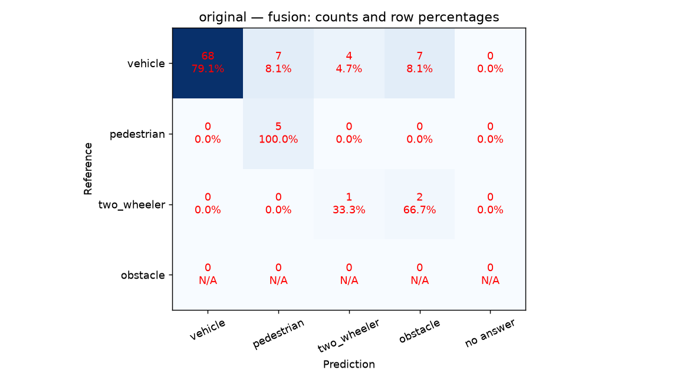
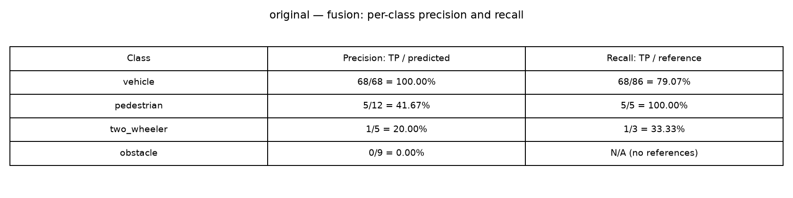

# Radar–Camera Perception: From Point Clouds to Multimodal Decisions

An educational autonomous-driving perception MVP combining **radar signal processing, density-based clustering, supervised machine learning, deep-learning detection and calibrated geometric projection**.

The project turns raw nuScenes sensor records into traceable candidate-level decisions and comparative reports. Its strongest contribution is an inspectable end-to-end system: every final prediction can be followed back to a radar candidate, its measurements and associated camera boxes.

> **Measured highlight:** on the current exploratory selection of 94 labeled radar candidates, fusion correctly classified **74/94 (78.72%)**, compared with **61/94 (64.89%)** for the camera-associated baseline and **25/94 (26.60%)** for radar alone. The gain over the camera baseline is **13 additional correct candidate classifications, or 13.83 percentage points**. These are candidate-level results under a provisional geometric labeling protocol—not object-detection mAP or evidence of production readiness.



## Purpose and scope

The motivating hypothesis is that complementary sensors can preserve useful perception when one source is limited. The camera supplies semantic appearance; radar supplies spatial returns and compensated velocity measurements. The implementation explores this complementarity without requiring a large end-to-end neural network.

The implemented system covers front-facing perception using `RADAR_FRONT` and `CAM_FRONT`. It does not control steering or braking. YOLO11n uses pretrained weights; camera fine-tuning, temporal tracking, multi-sweep accumulation and physically realistic weather evaluation remain future work.

The current fusion is **geometric association followed by an explicit camera-priority decision rule with radar fallback**. It is not a learned, calibrated or weather-adaptive fusion model.

## Architecture



Annotations enter the **audit and evaluation branch**, never the classifier feature vector or inference decision rule.

## Results and how to read them

The consolidated experiment selects five evenly spaced samples from each of `scene-0103` and `scene-0916`: **10 acquisitions, four scenarios and 40 visual panels**. The model used is `evaluation_model.joblib`, trained on the eight development scenes. The selected references contain **86 vehicle, five pedestrian and three two-wheeler candidates**; there are no obstacle references in this small selection.

| Scenario | Radar correct / all | Camera correct / all | Fusion correct / all |
|---|---:|---:|---:|
| Original image | 25/94 — 26.60% | 61/94 — 64.89% | **74/94 — 78.72%** |
| Brightness multiplied by 0.2 | 25/94 — 26.60% | 60/94 — 63.83% | **73/94 — 77.66%** |
| Gaussian blur, radius 5 | 25/94 — 26.60% | 60/94 — 63.83% | **71/94 — 75.53%** |
| Camera detections unavailable | **25/94 — 26.60%** | 0/94 — 0% | **25/94 — 26.60%** |

Radar input is unchanged across these scenarios. Darkening and blur are controlled image perturbations, **not physical simulations of rain**. Camera outage is modeled by supplying no detections; the displayed image remains a visual reference.

Fusion improves correct-over-all in the three image scenarios and preserves radar-only operation during camera outage. This demonstrates fallback and additional candidate coverage in the selected experiment. It does not establish a universal advantage under adverse weather.

The tradeoff is explicit: with original images, the camera baseline answers 61 candidates and gets all 61 correct under this protocol; fusion answers 94, gets 74 correct and makes 20 errors. **More answers and more total correct decisions do not imply higher precision among answered cases.**

The camera baseline uses the highest-scoring supported associated box, matching the fusion box-selection rule. Its missing answers include absent detections and failures of geometric association. A camera prediction may be reused for multiple radar candidates, so these are not independent detection trials. Camera-only detections without a labeled radar candidate are excluded from these metrics.

### Metrics

For each class:

$$Precision = \frac{TP}{TP+FP}, \qquad Recall = \frac{TP}{TP+FN}, \qquad F_1=\frac{2PR}{P+R}.$$

The report also separates:

- **Coverage:** answered candidates / all labeled candidates.
- **Correct-over-all:** correct candidates / all labeled candidates; unanswered cases do not count as correct.
- **Conditional accuracy:** correct candidates / answered candidates.

Confusion matrices have reference classes on rows, predictions on columns and a separate `no answer` column. Unanswered references contribute to false negatives. Each cell displays its count and row percentage. Undefined precision or recall is displayed as unavailable instead of claiming a measured zero.

Open [the HTML report](final_results/report.html) locally for all comparisons. GitHub displays the Markdown and PNGs; download or open the HTML locally for its full layout.




## Radar: techniques and reasons

### Reading and preserving measurements

The official `RadarPointCloud` reader provides the 18 radar fields. The project retains them in an `N x 18` matrix and explicitly broadens the reader's state selection. Additional filtering defaults to finite XYZ coordinates, preserving sparse measurements for analysis.

Quality is recorded separately using the invalid-state and ambiguity fields (`invalid_state == 0`, `ambig_state == 3`). This distinction prevents a strict quality filter from silently removing much of an already sparse acquisition. Original point indices are preserved through filtering, clustering and projection.

### DBSCAN and candidate construction

DBSCAN groups points using XY Euclidean distance with default `eps=1.5` metres and `min_samples=2`. It discovers groups without requiring a predefined object count. XY is used because radar elevation is not sufficiently informative here to justify treating Z as an equally useful clustering dimension. XYZ is still preserved for geometric transformations.

Noise points are retained individually as `isolated_return` candidates. A candidate is a possible object-supporting group, not a confirmed object. Cluster extents are return extents, not physical object dimensions.

Parameter exploration evaluates supported annotation boxes, cluster coverage, fragmentation and ambiguous associations. Matching the total number of clusters to the number of annotations would be insufficient: over-segmentation and merging can cancel numerically.

### Geometric labeling

Annotated 3D boxes are transformed into the radar frame. Their XY footprints are represented by convex hulls. Point membership is evaluated through hull half-space inequalities, with a small numerical tolerance.

A candidate receives a provisional label only when it supports exactly one box and at least 50% of its points lie inside that footprint. Multiple supported boxes are ambiguous. Unsupported categories and candidates without accepted associations remain unlabeled; they are **not automatically background**.

The expensive box masks are computed once per acquisition and reused by candidates. This eliminated repeated geometry calculations and made full development-scene processing practical on CPU.

### Eight interpretable features

| Feature | Purpose |
|---|---|
| `num_points` | Amount of radar support |
| `extent_x`, `extent_y` | Spatial spread in the radar plane |
| `mean_rcs` | Mean finite radar cross-section measurement |
| `mean_compensated_speed` | Mean magnitude of selected compensated XY velocity measurements |
| `num_rcs_points` | Support for the RCS statistic |
| `num_velocity_points` | Support for the velocity statistic |
| `quality_fraction` | Fraction passing the quality criteria |

Missing measurements remain `NaN` until a median imputer fitted on training data handles them. Compensated speed is a measurement summary, not a verified full object velocity. Annotation categories, tokens and instance identifiers are excluded from model inputs.

### Clusters versus isolated returns

In the current 10-sample report, clusters achieved **18/39 = 46.15%**, while isolated returns achieved **7/55 = 12.73%** radar classification accuracy. The complete 81-sample reserved evaluation previously yielded **181/342 = 52.92%** for clusters and **55/533 = 10.32%** for isolated returns.

These results motivate using spatially grouped measurements: clusters provide extents and aggregated measurements unavailable from a single return. However, the groups represent different populations. A causal claim that DBSCAN improves accuracy requires a matched ablation with and without clustering, which has not been completed.

## Machine learning and validation

The radar path includes a decision-tree baseline and three forest alternatives:

- Random Forest with inverse-frequency class weights.
- Balanced Random Forest with per-tree balanced sampling.
- Random Forest with moderate square-root inverse-frequency weights.

The forest configurations use 100 trees, maximum depth 8, minimum leaf size 2 and seed 42. The balanced forest uses `sampling_strategy="all"`, replacement sampling, no additional bootstrap stage and no extra class weights. Depth and leaf limits constrain complexity; they do not guarantee absence of overfitting.

Four-fold `StratifiedGroupKFold` keeps entire scenes together, approximately preserving class balance. Imputation, class weights and optional instance weights are fitted using each fold's training partition only. Inverse-instance weighting was explored to reduce repeated-object dominance, but is disabled in the saved comparison.

On **2,562 development candidates**, pooled out-of-fold results were:

| Model | Accuracy | Macro F1 | Minority macro recall |
|---|---:|---:|---:|
| RF, balanced class weights | 56.28% | 28.46% | 31.89% |
| Balanced RF | 48.28% | 25.97% | **35.77%** |
| RF, moderate weights | **84.54%** | **33.26%** | 11.52% |

Balanced RF was selected by a declared priority: minority macro recall, then macro F1, then vehicle recall. It is not the best under every objective. The moderate forest's higher overall accuracy coexists with weak minority recall.

The full dataset construction processed 404 samples, yielding 37,408 candidates: 3,437 provisionally labeled and 33,971 unlabeled. There are 2,562 development labels and 875 reserved labels.

Two artifacts have distinct purposes:

| Artifact | Training scope | Correct use |
|---|---|---|
| `evaluation_model.joblib` | Eight development scenes | Exploratory evaluation on the other two scenes |
| `final_model.joblib` | All ten mini scenes | Integration demonstrations; no independent mini-scene evaluation |

The reserved scenes have been inspected repeatedly during development and in the earlier project. Consequently, they are not a pristine final test set for the evolved fusion policy.

## Camera: deep learning and image representation

Images are loaded as RGB `uint8` arrays, with calibration, timestamp and ego pose retained. Pillow inputs avoid the RGB/BGR ambiguity of passing arrays directly to an API expecting BGR.

YOLO11n supplies pretrained 2D detections at confidence threshold 0.25 and requested inference size 960. GPU selection is automatic through PyTorch CUDA availability; radar processing remains on CPU. The development machine uses an NVIDIA RTX 4050 Laptop GPU with approximately 6 GB VRAM.

The semantic mapping is intentionally explicit:

| Project class | Camera categories | Radar annotation mapping |
|---|---|---|
| `vehicle` | car, truck, bus | Supported vehicle categories excluding bicycle/motorcycle |
| `pedestrian` | person | Adult, child, construction worker, police officer |
| `two_wheeler` | bicycle, motorcycle | Bicycle, motorcycle |
| `obstacle` | No supported mapping | Barrier, traffic cone |

Class coverage differs between sensors. `obstacle` is not an arbitrary catch-all for unknown camera objects. No YOLO fine-tuning has been performed.

An early single-image measurement showed 5.17 seconds for first inference and 39.706 ms for the second. This illustrates initialization overhead, not a sustained throughput benchmark.

## Geometry and fusion

Using homogeneous transforms, a radar point reaches the camera frame through:

$$p_c = T_{c\leftarrow e_c}\,T_{e_c\leftarrow w}\,T_{w\leftarrow e_r}\,T_{e_r\leftarrow r}\,p_r.$$

The two ego poses account for vehicle motion between radar and camera acquisition. They do not compensate independently moving objects. One inspected pair differed by 51.718 ms.

Quaternions are converted to rotation matrices. For row-vector arrays, forward transformation is `points @ R.T + t`; the inverse is `(points - t) @ R`.

The pinhole projection is:

$$u=f_xX/Z+c_x,\qquad v=f_yY/Z+c_y.$$

Points with invalid coordinates, nonpositive depth, depth at or below the configured minimum or pixels outside the image are accounted for separately. Radar range is Euclidean distance from the radar; camera depth is Z in the camera frame. They are not interchangeable.

Association checks projected point membership in detector boxes. Exclusive, shared and unmatched points are retained. A point inside a box is geometric support, not proof of object membership or visibility.

### Final selection policy

1. Choose the highest-scoring associated camera box with a supported category.
2. Use that camera category, including when radar disagrees.
3. If no supported camera category exists, use the radar prediction.
4. Retain uncertainty only when neither supplies a supported category.

Scores from different models are not averaged or directly ranked against each other. The evidence-gate fields remain diagnostics; the current selection prioritizes available categories rather than rejecting them with the earlier gates. This is a deliberate coverage-first heuristic, not probability calibration.

## Engineering difficulties and resolutions

| Difficulty | Resolution and learning |
|---|---|
| Experimental NumPy build warnings in the base environment | A dedicated `radar-mvp` environment isolated scientific dependencies. |
| `src` imports failing from notebooks/scripts | Entry scripts resolve the project root and insert it into the import path. |
| Sparse radar data and restrictive filtering | Finite-coordinate filtering, separate quality flags and retention of isolated returns. |
| Slow geometric audit | Cache each annotation footprint mask once per acquisition. GPU was not responsible for this radar speedup. |
| Dominant vehicle class | Compare balancing strategies and report per-class, macro and minority metrics. |
| Correlated frames and preprocessing leakage | Scene-grouped folds and training-only imputation/weights. |
| Missing speed measurements | Preserve missingness and report measurement-support counts. |
| Radar/camera frame mismatch | Explicit extrinsics, both ego poses and intrinsic projection. |
| NaN propagation in synthetic rotation tests | Compare valid coordinates separately and verify invalid points remain invalid. |
| Duplicate camera boxes | Preserve ambiguity; current decision rule selects the highest camera score without claiming unique object identity. |
| Incomparable model scores | Keep scores separate and inspect empirical correctness rather than averaging them. |
| Excessive abstention | Introduce camera priority and radar fallback, while reporting the accompanying errors. |
| Script moved into `src/fusion` | Correct root resolution so outputs remain in the top-level `final_results`. |

Integrated checks were developed after completing each module: known transforms, inverse transforms, projection, empty inputs, index preservation, overlap, class mapping and decision cases. **Some historical runner assertions encode the earlier conservative fusion policy and need updating before being treated as a current regression suite.** The consolidated report runner is the entry point for the current policy.

## Repository guide

| Location | Responsibility |
|---|---|
| `src/radar/reader.py`, `filters.py` | Acquisition and measurement selection |
| `src/radar/clustering.py`, `parameter_search.py` | Candidate construction and geometric parameter analysis |
| `src/radar/audit.py`, `labels.py` | Provisional reference association and category mapping |
| `src/radar/features.py`, `dataset.py` | Feature engineering and provenance-aware dataset construction |
| `src/radar/split.py`, `validation.py` | Scene partitions, grouped cross-validation and instance weights |
| `src/radar/model.py`, `final_train.py` | Classifiers, model selection, evaluation and serialized artifacts |
| `src/radar/visualization.py` | Radar and annotation diagnostics |
| `src/camera/reader.py`, `detector.py` | RGB input and pretrained YOLO inference |
| `src/fusion/projection.py`, `association.py` | Coordinate conversion and point-to-box membership |
| `src/fusion/decision.py`, `final_class.py` | Candidate correspondence, prediction comparison and final policy |
| `src/fusion/final_project.py`, `result_reporting.py` | Consolidated experiment and descriptive report |
| `notebooks/` | Development runners and interactive experiments |
| `models/camera/` | Downloaded YOLO weights |
| `src/radar/results/` | Historical training reports, folds and model artifacts |
| `final_results/` | Current consolidated HTML, CSV, JSON and PNG outputs |

## Reproducing the consolidated experiment

Use the Python environment containing NumPy, SciPy, scikit-learn, imbalanced-learn, nuScenes-devkit, pyquaternion, Pillow, Matplotlib, joblib, PyTorch and Ultralytics. Python 3.12 and NumPy 1.26.4 were used during radar development. CUDA-capable PyTorch is required for GPU inference; CPU fallback is supported. The repository is not yet distributed with a fully locked environment.

Extract nuScenes mini so the following paths exist:

```text
data/downloads/v1.0-mini/
├── samples/
├── sweeps/
├── maps/
└── v1.0-mini/       # JSON metadata
```

From the repository root, with the environment active:

```powershell
python -B src/fusion/final_project.py
```

The runner currently expects the saved evaluation artifact in `src/radar/results/final_training_balanced_random_forest_2026-10-13_11-32-39/`. Update its `source` path when using another training run. YOLO weights are stored in `models/camera/yolo11n.pt` and may be downloaded on first use.

Running the experiment regenerates named outputs in `final_results`, including:

- `report.html`: narrative and comparative visual report.
- `summary.json`: aggregate counts and rates.
- `metrics.csv`: sample/scenario/sensor counts.
- `predictions.csv`: candidate references and predictions.
- `comparison.png`: coverage and correct-over-all.
- `confusion_*.png`: 12 confusion matrices.
- `metrics_*.png`: 12 numerical precision/recall figures.
- Scene/sample/scenario PNGs: 40 three-panel visual diagnostics.

Training can be reproduced with `python -B src/radar/final_train.py`; it creates a new timestamped results directory. Adjust the consolidated runner to use its evaluation artifact, not its all-scenes final model. Retain metadata, source hashes and feature schema when comparing runs.

## Interpretation boundaries and next work

The results are encouraging evidence of **candidate-level complementarity and usable sensor fallback**, but several questions remain open:

- Only two previously inspected scenes and ten selected frames support the consolidated comparison.
- Candidates are correlated and labels come from XY geometry; no independence or confidence interval is claimed.
- An always-vehicle reference would classify 86/94 candidates correctly (91.49%) on this imbalanced selection. Therefore the headline fusion accuracy alone is insufficient to establish robust multiclass performance.
- Camera boxes are not evaluated against a full 2D detection benchmark; no mAP claim is made.
- Lack of a box can reflect field of view, occlusion, missed detection or association error—not only sensor failure.
- Radar degradation is not simulated, and actual rain/night robustness remains untested.
- Repeated policy changes on inspected scenes mean a new untouched evaluation set is needed.
- The current system has no temporal tracks or definitive object-level consolidation.

Next steps are a matched DBSCAN ablation, camera detection evaluation, scene-separated calibration, real adverse-weather data, controlled radar degradation, camera fine-tuning and temporal fusion. These extend an existing, traceable pipeline rather than replacing its diagnostic foundations.

## Technical references

- [nuScenes dataset and tutorials](https://www.nuscenes.org/tutorials/nuscenes_tutorial.html)
- [nuScenes devkit: sensor-to-camera projection](https://github.com/nutonomy/nuscenes-devkit/blob/master/python-sdk/nuscenes/nuscenes.py)
- [DBSCAN — scikit-learn](https://scikit-learn.org/stable/modules/generated/sklearn.cluster.DBSCAN.html)
- [StratifiedGroupKFold — scikit-learn](https://scikit-learn.org/stable/modules/generated/sklearn.model_selection.StratifiedGroupKFold.html)
- [Balanced Random Forest — imbalanced-learn](https://imbalanced-learn.org/stable/references/generated/imblearn.ensemble.BalancedRandomForestClassifier.html)
- [YOLO11 — Ultralytics](https://docs.ultralytics.com/models/yolo11/)
- [Probability calibration — scikit-learn](https://scikit-learn.org/stable/modules/calibration.html)

Dataset and pretrained-model redistribution remain subject to their respective provider licenses. No repository license is asserted by this README.
